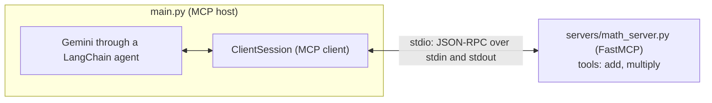
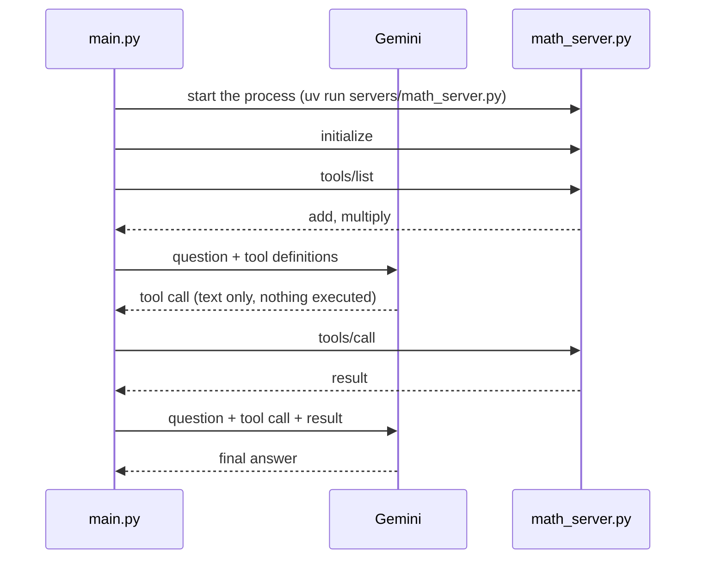

# MCP Course

A hands-on Model Context Protocol (MCP) project: a **Math MCP server** and a **LangChain and LangGraph agent** that discovers the server's tools and uses them to answer a question, powered by Gemini.

It is part of  [Agentic AI Course](https://github.com/Haneenmohammed1311/Agentic-AI), and the theory behind it is in my [MCP notes](https://github.com/Haneenmohammed1311/Agentic-AI/blob/main/notes/model-context-protocol.md).

## What it does

The host app (`main.py`) starts the Math server, asks it which tools it has, hands those tools to a Gemini-powered agent, and asks "What is 54 + 2 * 3?". The agent calls the server's `add` and `multiply` tools, which run in the server process, not in the agent.





## Files

| File | Role |
|---|---|
| `servers/math_server.py` | MCP server with two tools, `add` and `multiply`, over **stdio** |
| `servers/weather_server.py` | The same idea over **SSE**: `mcp.run(transport="sse")` |
| `main.py` | The host: connects to the Math server and runs the agent |
| `.env` | `GOOGLE_API_KEY`, and optional LangSmith settings |

## The server

```python
from fastmcp import FastMCP

mcp = FastMCP("Math")


@mcp.tool()
def add(a: int, b: int) -> int:
    """Add two numbers"""
    return a + b


@mcp.tool()
def multiply(a: int, b: int) -> int:
    """Multiply two numbers"""
    return a * b


if __name__ == "__main__":
    mcp.run(transport="stdio")
```

The function name becomes the tool name, the docstring becomes the description the model reads, and the type hints become the input schema. Nothing else is needed.

## The host

```python
import asyncio

from dotenv import load_dotenv
from langchain.agents import create_agent
from langchain_core.messages import HumanMessage
from langchain_google_genai import ChatGoogleGenerativeAI
from langchain_mcp_adapters.tools import load_mcp_tools
from mcp import ClientSession, StdioServerParameters
from mcp.client.stdio import stdio_client

load_dotenv()

llm = ChatGoogleGenerativeAI(model="gemini-3.1-flash-lite")

stdio_server_params = StdioServerParameters(
    command="uv",
    args=["run", "servers/math_server.py"],
)


async def main():
    async with stdio_client(stdio_server_params) as (read, write):
        async with ClientSession(read_stream=read, write_stream=write) as session:
            await session.initialize()
            print("Session initialized with MCP Math Server!")

            tools = await load_mcp_tools(session)
            agent = create_agent(llm, tools)

            result = await agent.ainvoke(
                {"messages": [HumanMessage(content="What is 54 + 2 * 3?")]}
            )

            print("\n--- Agent Answer ---")
            content = result["messages"][-1].content
            if isinstance(content, list):
                print(content[0]["text"])
            else:
                print(content)


if __name__ == "__main__":
    asyncio.run(main())
```

What each piece does:

| Piece | What it does |
|---|---|
| `StdioServerParameters` | The command that starts the server. The client launches it as a child process. |
| `stdio_client(...)` | Starts that process and gives back a read stream and a write stream connected to its stdout and stdin. |
| `ClientSession(...)` | Speaks the MCP protocol over those two streams. |
| `session.initialize()` | The handshake before anything else. |
| `load_mcp_tools(session)` | Calls `tools/list` and wraps each MCP tool as a normal LangChain tool. Each later call becomes a `tools/call`. |
| `create_agent(llm, tools)` | The same agent loop as the earlier lessons, now using MCP tools. |
| `agent.ainvoke(...)` | Async only. MCP tools do not support sync invocation. |

Because this uses one long-lived `ClientSession`, the server process stays alive for the whole run.

### Output

```
Session initialized with MCP Math Server!

--- Agent Answer ---
54 + 2 * 3 = 60
```

[Example LangSmith trace](https://aws.smith.langchain.com/public/0c2146b7-4a55-4d22-886e-eb6488cdcdbe/r/01a17d42-994f-7196-a903-39dc97fc5c9d?start_time=2026-10-27T12%3A07%3A59.055659Z) of a run. In the trace, look for the model calls and for tool calls named `add` or `multiply`. A correct answer alone does not prove a tool was used, because a model can do simple arithmetic itself. The trace is how to check.

## Testing the server without an LLM: MCP Inspector

The Inspector acts as the host, and you act as the LLM. It needs Node 22.19 or newer and no API key.

```powershell
npx @modelcontextprotocol/inspector C:\Users\<you>\MCP-Course\.venv\Scripts\python.exe C:\Users\<you>\MCP-Course\servers\math_server.py
```

1. **Open the URL printed in the terminal.** It contains a session token. Typing the address by hand will not authenticate.
2. **Servers screen:** the command you passed appears as a server. Connect to it.
3. **Tools tab:** list the tools, pick `add`, enter `a` and `b`, and run it.
4. **Protocol tab:** shows the raw JSON-RPC messages: the handshake, `tools/list`, and `tools/call`. This is the best way to see what `load_mcp_tools` hides.
5. **Console tab:** shows what the server writes to stderr, such as the FastMCP log line.

There is also a command-line mode:

```powershell
npx @modelcontextprotocol/inspector --cli <python> servers\math_server.py --method tools/list
npx @modelcontextprotocol/inspector --cli <python> servers\math_server.py --method tools/call --tool-name add --tool-arg a=2 --tool-arg b=3
```

The call returns `content` (text for the model), `structuredContent` (the same result as data), and `isError`.

## Transports: stdio, SSE, Streamable HTTP

| | stdio | SSE | Streamable HTTP |
|---|---|---|---|
| Who starts the server | The client, as a child process | You, before connecting | You, before connecting |
| How the client connects | stdin and stdout | `http://127.0.0.1:8000/sse` | `http://127.0.0.1:8000/mcp` |
| Server code | `mcp.run(transport="stdio")` | `mcp.run(transport="sse")` | `mcp.run(transport="http")` |
| Good for | Local tools, one client | Older remote setups | Remote servers, many clients |

- With stdio, never run the server by hand. It waits on stdin, so the terminal looks stuck. Let the client or Inspector start it.
- With SSE, start the server first and leave it running. The client connects to its URL. The port must be free, so only one server can use 8000 at a time.
- The default addresses above are the `fastmcp` defaults. I confirmed SSE and Streamable HTTP with `fastmcp` 3.4.11, and SSE with 4.1.3, using an `mcp` 1.30 client.
- The current MCP documentation lists only stdio and Streamable HTTP as standard transports. SSE is the older HTTP transport.

## Problems I faced

| Problem | Cause | Fix |
|---|---|---|
| **Version clash between `fastmcp` and the LangChain adapters** | `fastmcp` 4.x installs `mcp` 2.x, but `langchain-mcp-adapters` 0.3.2 requires `mcp<2`. The resolver can quietly choose the older adapter 0.3.1, which installs but fails on import (`cannot import name 'RequestContext' from 'mcp.shared.context'`) | Pin `fastmcp<4` before adding the adapters, or keep the server and the host in separate environments |
| `ModuleNotFoundError: No module named 'mcp.server.fastmcp'` | The instructor's import exists in `mcp` 1.x only. In `mcp` 2.x it was renamed to `MCPServer` | Use `from fastmcp import FastMCP` (the standalone package), pin `mcp<2`, or use `MCPServer` |
| Three things called FastMCP | `mcp.server.fastmcp` (inside `mcp` 1.x), the standalone `fastmcp` package (versions 2 to 4 so far), and `MCPServer` in `mcp` 2.x | Check which package a tutorial imports from and match your installed version |
| `create_react_agent` deprecation warning | It moved in LangGraph 1.0 and will be removed in 2.0 | `from langchain.agents import create_agent` |
| `ChatOpenAI` in the course code | The course uses OpenAI, I use Gemini | `ChatGoogleGenerativeAI`, with `GOOGLE_API_KEY` in `.env` |
| Final answer printed as a list of blocks | Gemini returns `content` as a list of blocks, and so do MCP tool results | Check `isinstance(content, list)` and read the `text` field |
| Hard-coded macOS path in the instructor's `main.py` | `/Users/edenmarco/...` does not exist on Windows | Use a path relative to the project root, or `sys.executable` with a `Path(__file__)` based path |
| Server terminal looks stuck after the FastMCP banner | A stdio server waits for messages on stdin | Start it through Inspector or the host. Press Ctrl+C to stop it |
| `print("HEllo")` after `mcp.run(...)` never appeared | `mcp.run` blocks until the server stops. It also prints to stdout, which is the protocol channel | Remove it, or log to stderr or with `logging` |
| Banner and "update available" lines | They go to stderr and do not break the protocol | `mcp.run(transport="stdio", show_banner=False)` if you want them gone |
| Inspector page opened but nothing happened | The page needs the token from the terminal URL, and you must connect to the server first | Use the printed URL, then connect, then use the Tools tab |
| `agent.invoke` fails with MCP tools | MCP tools only support async calls | Use `await agent.ainvoke(...)` |

### Versions that worked 


| Package | Version |
|---|---|
| Python |3.13|
| fastmcp |2.14.1|
| mcp |1.30.0|
| langchain-mcp-adapters |0.3.1 |
| langchain |1.4.7 |
| langgraph |1.2.17  |
| langchain-google-genai |4.4.2  |

## Setup

```bash
git clone https://github.com/Haneenmohammed1311/MCP-Course.git
cd MCP-Course
uv sync
```

Create a `.env` file:

```
GOOGLE_API_KEY=your_key_here
```

Optional LangSmith tracing: `LANGSMITH_TRACING=true`, `LANGSMITH_API_KEY`, `LANGSMITH_PROJECT`.

## Run

```bash
uv run python main.py
```

Run it from the project root, because the server path in `main.py` is relative. Each question costs at least two Gemini calls, and more when the agent calls tools one after another, so mind the free-tier daily quota.

## Safety

A stdio server is a program running on your machine with your permissions. The Math server is harmless, but a server with a tool like "run any shell command" is not. Only run servers you wrote or trust, read approval prompts before accepting them, and see the security section of my MCP notes.

## What I learned

- An MCP server owns the tools and runs their code. The LLM and the host only send requests.
- The agent loop is the same as before. Only the "execute" step moved into a separate process.
- stdio and SSE differ in who starts the server, not in what the messages mean.
- Package versions matter as much as the code: three libraries with similar names and incompatible pins cost me more time than the protocol itself.